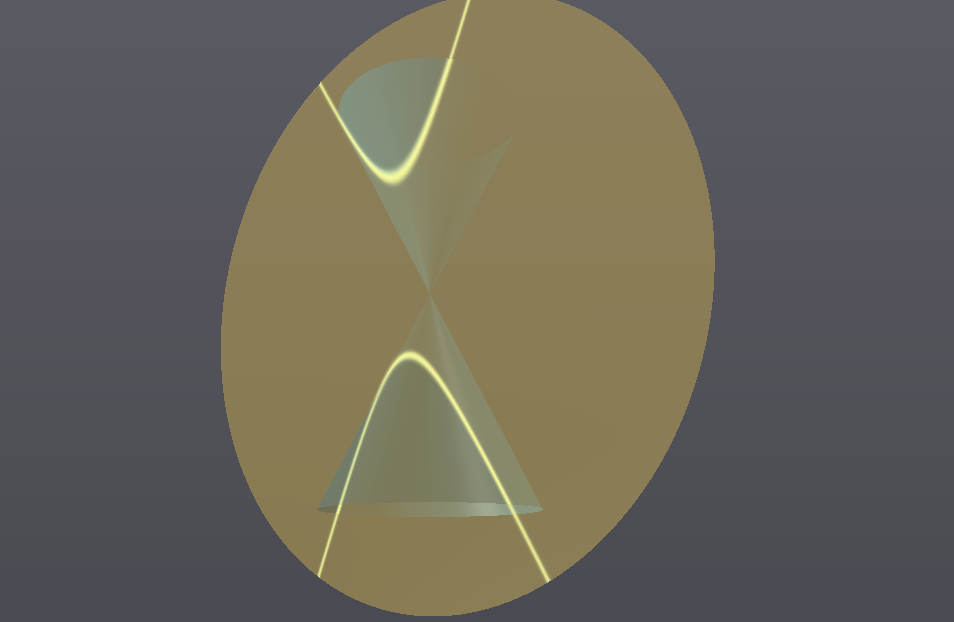

# RayTracing_01

A real-time ray tracer for macOS, written in **Swift** and **Metal**. Two animated demos show how 3D surfaces intersect. The math runs entirely on the GPU, and every pixel is computed by tracing a ray from the camera into the scene.



## Demos

### Conic Sections
A transparent double cone is cut by a slowly tilting plane. As the plane tilts, the glowing line where it meets the cone changes shape, passing through all four conic sections:

| Plane tilt (from horizontal) | Curve |
|---|---|
| 0° | Circle |
| 0° – ~64° | Ellipse |
| ~64° (parallel to the cone's side) | Parabola |
| ~64° – 85° | Hyperbola |

### Cone & Sphere
A cone with its tip at the center of a sphere rotates freely. Wherever the cone points, it meets the sphere in a circle, which is highlighted as it sweeps across the sphere's surface.

In both demos the camera slowly orbits the scene.

## How it works

The app doesn't build triangle meshes for the cone, plane, or sphere. It draws one full-screen quad, and the **fragment shader** ray-traces each pixel:

1. **Ray generation:** each pixel's screen position is unprojected through the inverse view-projection matrix to get a ray in world space.
2. **Analytic intersection:** the ray is tested against exact equations for each shape. A cone and a sphere each lead to a quadratic equation; a plane leads to a linear one.
   - Double cone: `x² + z² = (y · tan α)²`
   - Cone with any axis: `(v·a)² − cos²α · |v|² = 0`
   - Sphere: `|p − c|² = r²`
3. **Transparency:** all hits along the ray are sorted by distance and blended front to back, so you can see through every surface.
4. **Shading:** Blinn-Phong lighting (ambient, diffuse, and specular).
5. **Intersection highlight:** each hit point measures its distance to the *other* surface. Points close to it glow yellow, and those points trace out the curve where the two shapes meet.

## Project structure

| File | Purpose |
|---|---|
| `RayTracingApp.swift` | App entry point |
| `ContentView.swift` | Start screen with a button for each demo |
| `DemoType.swift` | List of demos: titles, descriptions, and which shader functions each uses |
| `MetalView.swift` | Puts an `MTKView` inside SwiftUI (`NSViewRepresentable`) |
| `Renderer.swift` | Metal setup, per-frame uniforms, orbiting camera, matrix math |
| `ShaderTypes.h` | Structs and buffer indexes shared by Swift and Metal |
| `Shaders.metal` | Vertex and fragment shaders, intersection tests, and lighting |

## Requirements

- macOS 26.4 or later
- Xcode 26 or later
- A Mac with Metal support (any Apple silicon Mac)

## Building and running

1. Clone the repository:
   ```bash
   git clone https://github.com/wrenholt/RayTracing_01.git
   ```
2. Open `RayTracing_01.xcodeproj` in Xcode.
3. Under **Signing & Capabilities**, pick your own development team.
4. Press **⌘R** to build and run.
5. Choose a demo from the start screen.

## Adding a new demo

1. Add a case to `DemoType` in `DemoType.swift`, with a title, a description, and the names of its shader functions.
2. In `Shaders.metal`, write a vertex function (you can copy one of the existing full-screen quad shaders) and a fragment function that traces your scene.

The start screen picks up the new demo automatically.

## Acknowledgments

Developed with assistance from [Claude](https://claude.ai) (Anthropic).

## License

This project is licensed under the MIT License. See [LICENSE](LICENSE) for details.
